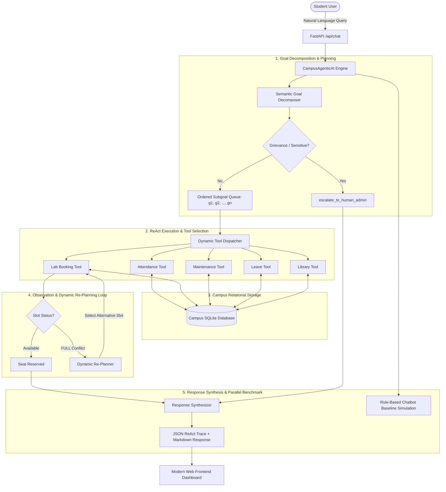
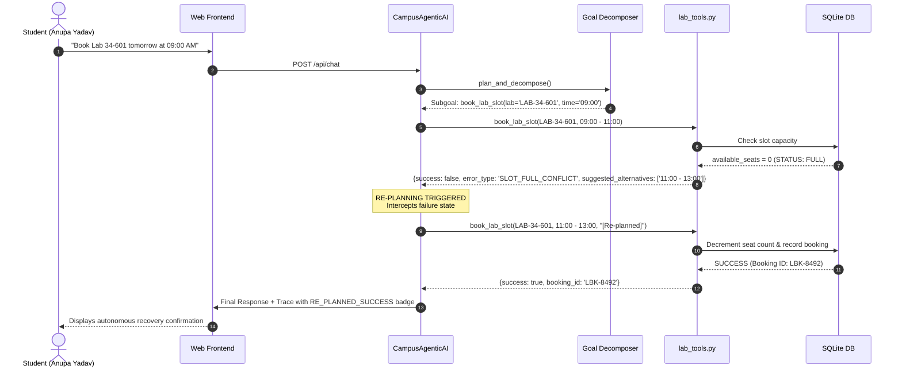
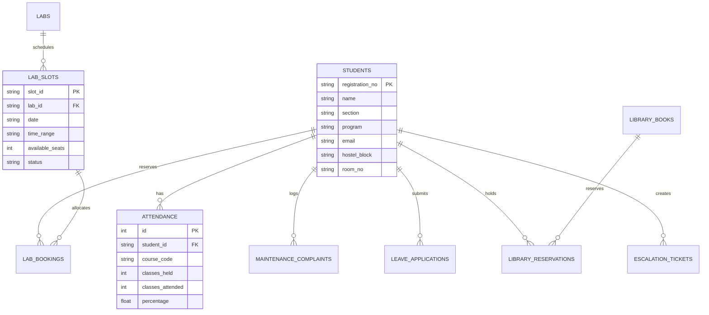

# SYSTEM ARCHITECTURE SPECIFICATION
## Agentic AI Assistant for Multi-Step Campus Workflows
**Course:** CSE276 Artificial Intelligence Foundations · Group 9 (Ruben Jose, Anupa Yadav, Erick Simon Kasole)

---

## 1. End-to-End ReAct Flowchart

---

## 2. Sequence Diagram: Conflict Detection & Autonomous Re-Planning

---

## 3. Database Entity-Relationship Architecture

